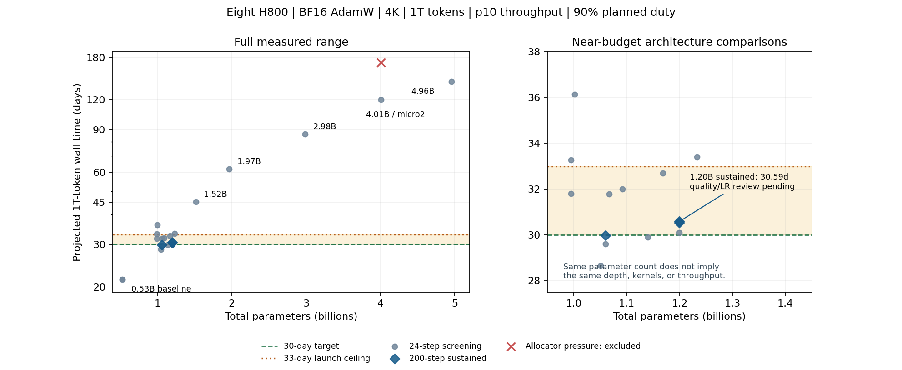
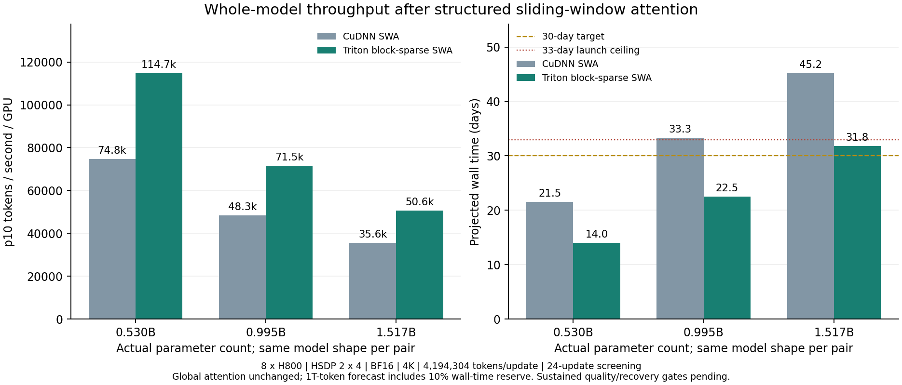
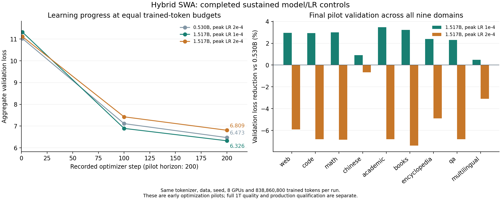

> 当前状态（2026-11-15T03:07:43.098067+00:00）：最新a138源码实际正式数据200步对照：1.5166B/LR1e-4 p10=49859.09 token/s/卡，1T/duty=.9预计32.24天；0.5301B为114294.93及14.06天。候选扩大验证八域及macro改善，但中文loss7.41749→7.49765，严格九域门禁FAIL。正式全量未开始。当前q13系统资格和真实模型WSD恢复进行中；另固定1.219B/1.002B×两个LR的正式分布对照排队。下文旧源码“选定/九类全优”为历史事实，不代表当前通过。以 `report/PRETRAIN_CURRENT_GATE_STATUS_20261114.md` 为当前状态。

# 八卡模型规模实测与选型（已选候选，生产资格进行中）

当前结论（2026-11-14）：选择 1.516600064B / 18L / H2560 / FFN6912 / 峰值 LR 1e-4，
后端 cudnn_flex_swa，持续实测 p10=49564.15234 tokens/s/GPU，1T / .9 duty 预计 32.432922 天。
候选生产配置已发布，正式训练尚未启动；实际数据、当前资格、恢复和生产 canary 仍须通过。
完整对照与证据见本文末尾 10:20 UTC 更新。

用户选择：允许接近 30 天，优先选择更大的模型；数据预处理持续运行。目标仍是 1T actual tokens、八卡 H800、BF16。

以下按时间保留原始实验过程，早期候选与后端结论由后续同源对照更新。

## 早期 CuDNN 路径短测（04:05 UTC）

每个候选 24 次更新，前 8 步排除，使用后 16 步的 p10；每次更新 4,194,304 tokens、4K、AdamW、HSDP 2×4、cuDNN SDPA 和模型编译。工期按 p10 × 8 × 90% 有效运行时间计算。30 天门槛为每卡 53,583.68 tokens/s。最终保存和九域验证发生在最后一次训练吞吐记录之后。

| 参数量 | 层数 / hidden / FFN | microbatch / accumulation | p10 tokens/s/卡 | MFU 中位数 | 1T 天数 | 状态 |
|---|---|---|---:|---:|---:|---|
| 0.530B | 16 / 1536 / 4096 | 8 / 16 | 74,768 | 25.51% | 21.5 | 短跑完成 |
| 0.995B | 18 / 2048 / 5504 | 8 / 16 | 48,308 | 30.89% | 33.3 | 短跑完成 |
| 1.002B | 24 / 1792 / 4864 | 8 / 16 | 44,472 | 28.90% | 36.1 | 短跑完成 |
| 1.517B | 18 / 2560 / 6912 | 8 / 16 | 35,593 | 34.34% | 45.2 | 短跑完成 |
| 1.966B | 24 / 2560 / 6912 | 4 / 32 | 26,066 | 32.71% | 61.7 | 短跑完成 |
| 2.985B | 26 / 3072 / 8192 | 4 / 32 | 18,604 | 35.03% | 86.4 | 短跑完成 |
| 4.010B | 30 / 3328 / 8960 | 4 / 32 | 9,388 | 25.61% | 171.2 | 显存重试；需小批量对照 |
| 4.957B | 32 / 3584 / 9728 | 2 / 64 | 11,262 | 35.10% | 142.7 | 短跑完成 |

第一组中尚无 1B 以上的模型满足 30 天目标。4B 的 microbatch 4 虽完成，但预热后有 16,301 条 allocator OOM 重试警告，不能作为调优后的可选结果；后续用 microbatch 2 对照。5B 的 microbatch 8/4 直接显存不足，microbatch 2 已完成。

第二组正在测试 14L/H2304（0.995B）、12L/H2560（1.067B）、10L/H2816（1.092B）、8L/H3072（1.060B），并重新测量并行条件下的基线。不同宽深形状会改变逐层开销与矩阵效率，结果出来前不把第一组结论推广到所有相同参数量的模型。相同模型 bytes、源码、microbatch 2 / accumulation 64 的 5B 对照已完成，因此不重复执行。

按本节点锁定的每卡 BF16 dense 峰值 989 TFLOP/s 和约 6ND 估算，4.957B/1T 在 100% 峰值与 90% duty 下仍需约 48.34 天；实际吞吐更低。较高 MFU 本身不能代替 token 吞吐和实际工期。

这些是吞吐筛选结果，不证明最终模型质量，也不签发 production PASS。新架构进入正式训练前仍需持续 canary、LR/数值/恢复验证、训练身份冻结及完整数据门禁。层数减少的候选还需检查验证集学习曲线。

机器证据：`data/health/model-size-sweep.json`、`model-width-followup.json`、`model-scale-sweet-point.json`、`model-scale-user-preference.json`；配置、逐次训练身份、结果及日志在 `experiments/e2_architecture/{configs,results}/gpu_size_sweep_20261114` 与独立 `data/experiments/` 路径。

## 四组八卡实测完成（2026-11-14 05:29 UTC）

用户选择：允许接近 30 天，优先更大模型。固定 1T、八卡 HSDP 2×4、4K、4194304 tokens/update、BF16 AdamW、duty=.9。研究短测通过不代表生产资格。

|候选|参数 B|micro/accum|p10 tokens/s/GPU|预计天数|稳态 allocator retries|30 天内|
|---|---:|---:|---:|---:|---:|---|
|baseline_053b_b8|0.5301|8/16|74767.6|21.50|0|是|
|size_15b_b8|1.5166|8/16|35592.7|45.16|0|否|
|size_1b_deep_b8|1.0020|8/16|44472.5|36.15|0|否|
|size_1b_wide_b8|0.9947|8/16|48307.8|33.28|0|否|
|size_2b_b4|1.9662|4/32|26065.5|61.67|0|否|
|size_2b_b8|1.9662|8/16|OOM|—|0|否|
|size_3b_b4|2.9855|4/32|18603.9|86.41|0|否|
|size_3b_b8|2.9855|8/16|OOM|—|0|否|
|size_4b_b4|4.0096|4/32|9388.0|171.23|16301|否|
|size_4b_b8|4.0096|8/16|OOM|—|0|否|
|size_5b_b2|4.9566|2/64|11261.9|142.74|0|否|
|size_5b_b4|4.9566|4/32|OOM|—|0|否|
|size_5b_b8|4.9566|8/16|OOM|—|0|否|
|baseline_053b_b8|0.5301|8/16|75119.1|21.40|0|是|
|size_1b_h2304_l14_b8|0.9951|8/16|50527.2|31.81|0|否|
|size_1b_h2560_l12_b8|1.0670|8/16|50579.0|31.78|0|否|
|size_1b_h2816_l10_b8|1.0922|8/16|50224.9|32.01|0|否|
|size_1b_h3072_l8_b8|1.0602|8/16|54280.4|29.61|0|是|
|size_4b_lowmem_control_b2|4.0096|2/64|13386.6|120.08|0|否|
|size_117b_h3072_l9_b8|1.1687|8/16|49168.7|32.69|0|否|
|size_123b_h3328_l8_b8|1.2329|8/16|48105.7|33.42|0|否|
|hybrid_8l_h3072_g4_b8|1.0507|8/16|56092.0|28.66|0|是|
|hybrid_8l_h3328_g2_b8|1.1996|8/16|53386.0|30.11|0|否|
|hybrid_9l_h3072_g2_b8|1.1404|8/16|53744.5|29.91|0|是|

当前最大合格候选 hybrid_9l_h3072_g2：1,140,385,920 参数、9L/H3072/FFN8192/attention_every2，共 4 global + 5 gated SWA；短测 p10=53744.457 tokens/s/GPU，29.9103 天。1.0507B every4 为更快后备，28.6584 天。约 1.20B 超出目标。

独立 200 步持续测试 PID 234400 正在运行，前 50 步排除，100/200 步保存及九域验证。LR/数值/恢复、数据身份继承、最终生产 canary 均未跳过。正式模型文件未变，正式训练未启动。

有效计算 MFU 与 GPU activity 不同；显式 mask 的 SWA 在当前 CuDNN 路径可能比 native causal global 更慢。层分布结论来自实际 TPS。

### 持续测试身份纠正（2026-11-14 05:46 UTC）

当前 selected_sustained_20261114 的真实模型是早先三组筛选所选 1.060163584B/8L/H3072/every6 后备，而非四组新结果 1.140385920B。排队进程缓存了新增第四组前的分析模块；state、模型字节及启动参数量一致，原结果保留为后备测试。用户进度说明已纠正。新独立 frontier_sustained_20261114/PID239937 等后备结束后测试 1.140385920B，显式校验四组 roster、candidate/参数量、analyzer SHA 和实际模型字节。不得将前者结果当作后者资格。

## 八卡实测图（持续更新）

来源：完成的24步筛选和200步持续测试，p10吞吐，固定1T、八卡、duty=.9；不代表新模型生产资格已通过。SVG及逐点JSON同目录保存。

## 2026-11-14 08:35 UTC：结构化滑窗内核改变可行区间

原先 CuDNN 显式布尔 mask 的 SWA 计算开销明显。当前可选 `cudnn_flex_swa` 后端对 SWA 使用 PyTorch 2.14 原生 Triton FlexAttention 的 block mask，全局层继续 CuDNN causal；保持原始 attention_every=6、window=128、GQA/QK norm/RoPE/输出门控与模型深度。没有安装新依赖，生产 base 仍未切换。

八卡独立算子测试覆盖 24/32/40/52 Q heads、两种输入布局、65/128/129/257 边界长度，BF16 输出及 Q/K/V 梯度对照 FP32 MATH；4K B8 算子前反向约提升 9.1–10.85 倍。进一步八卡实际编译 GQAAttention 模块测试，覆盖 BF16 参数与 FP32 主参数/autocast、滑窗和全局层及 4K B8，所有输出/输入梯度/参数梯度通过既定 .02 relative-L2/.05 normalized-max 误差门限。证据为 `data/health/flex-swa-pilot.json` 和 `flex-module-parity.json`。

下面是**整模型**短测，均为八卡 HSDP 2×4、BF16、4K、B8/A16、24 updates，排除前8次，取16点 p10；1T 估算包含10%工期预留。

| 完全相同的模型形状 | CuDNN SWA tokens/s/GPU | 结构化 SWA tokens/s/GPU | 原预计天数 | 新预计天数 |
|---|---:|---:|---:|---:|
|0.530107904B，16L/H1536|74767.6|114669.6|21.50|14.02|
|0.994652416B，18L/H2048|48307.8|71499.0|33.28|22.48|
|1.516600064B，18L/H2560|35592.7|50572.9|45.16|31.79|

额外 1.219045632B/14L/H2560 新后端为62480.4 tokens/s/GPU，25.73天。1.5166B 已进入33天硬门限，目前为优先待持续验证的较深候选。更大1.6687B与1.9662B仍在短测。短测不能替代200步持续质量与实际生产数据恢复门禁。

原计划 supervisor252952 在基线完成后因 GPU0 短暂出现未知 host PID964467而触发空闲检查停止。未终止未知进程。其自行退出后，256928 在校验原始计划、代码、模型/配置、已完成结果哈希及实际吞吐序列后恢复；已完成基线未重测/重标，原失败状态保留。恢复脚本增加每项测试前最多600秒的空闲等待。全套CPU回归实际当前实现 **617 PASS / 28 skip**。

后续 `run_flex_sustained_controls.py`（PID260134）已排队，待短测完成后对新后端同源0.53B基线和最大B8/A16可行候选进行200步对照；大模型分别用1e-4/2e-4峰值LR，保持数据/seed/模型及838,860,800训练tokens一致。记录全部九域质量和150个稳态吞吐点，结果仍须人工研究判断及新生产资格，未自动采用。

## 2026-11-14 09:54 UTC：1.5166B 的完整持续测试

新后端0.530107904B基线200updates完成：p10=114268.71875 tokens/s/GPU，1T/.9 duty预计14.0678天，最终九域等量验证样本的宏平均loss6.47328567505。

1.516600064B／18L／H2560／FFN6912／40Q10KV／attention_every6，峰值LR1e-4持续200updates完成：训练838,860,800tokens，排除前50步后150个完整稳态点，p10=49564.15234375 tokens/s/GPU，**保守预计32.432922天**，低于33天硬上限；不含10%运行余量的纯训练时间约29.19天。最终总验证loss**6.32604885101**，比新同后端0.53B基线降低.14723682404（约2.27%）；全部九域均改善。分域相对loss降低web2.962%、code2.942%、math3.007%、Chinese.919%、academic3.485%、books3.222%、encyclopedia2.391%、QA2.296%、multilingual.483%。这是0.84B-token早期优化对照，不能当作最终1T质量结论。比较方案同时改变模型规模和各自LR，未声称隔离的架构因果效应。

新1.5166B／2e-4对照仍在运行，完成后选择同模型可行LR。生产finalmodel文件仍是旧0.53B，尚未采用/开始正式训练。独立实际LR与checkpoint游标审计持续PASS。正式生产需要新数据完整审计、当前数值/故障恢复和实际warmup-prefix200步canary。

## 2026-11-14 10:20 UTC：最终对照完成并准备 1.5166B 生产契约

三组同后端持续对照均完成200 updates、838,860,800 tokens。较大模型两组使用完全相同的初始训练loss（11.6016139984）、模型、数据、seed和batch，差别为峰值LR。

|模型 / 峰值LR|200步总验证loss|p10 tokens/s/GPU|1T预计天数（duty=.9）|
|---|---:|---:|---:|
|0.530107904B / 2e-4|6.473285675|114268.71875|14.067807|
|1.516600064B / 1e-4|**6.326048851**|49564.15234|**32.432922**|
|1.516600064B / 2e-4|6.809368610|49649.02734|32.377478|

选择1.516600064B、18L/H2560/FFN6912、40Q10KV、attention_every6、window128、峰值LR1e-4进入正式资格验证。它是本次有界筛选内满足33天上限的最大实测模型；1.6687B预计34.764天被排除。1e-4在九域均优于同后端0.53B对照，也均优于同形状2e-4；不把200步早期结论推广成1T最终质量保证。研究判断及不可变证据见`experiments/e2_architecture/results/model-scale-scientific-assessment.json`和`model-scale-production-selection.json`。

已通过`prepare_production_model.py`先生成逐文件预览并检查差异，再持有实际生产OUT写租约发布正式候选model/base/env/authorization。全局4194304 tokens/update、238418更新、各阶段样本数及WSD时长完全保留；仅改模型、峰值LR、实测混合注意力后端、明确的block_permutation策略及测量时的OMP/编译缓存环境。历史0.53B模型和全部控制计划pinned_inputs已按SHA存入`data/processed/training_evidence`，旧结果仍可追溯。

**这是PUBLISHED_REQUIRES_FRESH_QUALIFICATION，正式训练未启动。** 数据原始frozen113/releaseDD28及正在运行的token controller/materializer均未改动。待全部实际stream配比/完整字节审计、PRODUCTION索引manifest、当前13项GPU资格、实际1.52B三阶段故障恢复、训练专用冻结及生产canary通过后才允许启动。quality图已包含全部三组，不再只有已完成的前两组。

## Current-source remeasurement — 2026-11-14T19:48:43.081640+00:00

After explicit source-window reader support, actual training source is `6a53b6054b8892ddbe69518bcc12155fbd1b2729a25a59c17209d36389a41157`. Fresh dedicated 200-update controls preserve the actual research data prefix, seed, batch B8/A16, HSDP2×4, backend, schedule, and all nine validation domains. Historical source2a results above remain historical. Last LR2e-4 control is still running; this section does not publish a refreshed final selection.

| Fresh control | p10 tokens/s/device | 1T days at duty .9 | Aggregate validation loss |
|---|---:|---:|---:|
| matched_baseline_b8 | 112221.929688 | 14.324386 | 6.444028378 |
| larger_lr1e4_b8 | 49385.343750 | 32.550351 | 6.317607880 |

| Domain | Fresh 0.53B baseline loss | Fresh 1.52B LR1e-4 loss | Delta |
|---|---:|---:|---:|
| web | 5.932611465 | 5.764140129 | -0.168471336 |
| code | 6.245239258 | 6.073163033 | -0.172076225 |
| math | 5.733753681 | 5.579228878 | -0.154524803 |
| chinese | 7.881536007 | 7.866040230 | -0.015495777 |
| academic | 5.731909275 | 5.549519062 | -0.182390213 |
| books | 5.689106941 | 5.526935577 | -0.162171364 |
| encyclopedia | 6.505624294 | 6.369864941 | -0.135759354 |
| qa | 5.918694019 | 5.799653053 | -0.119040966 |
| multilingual | 8.357780457 | 8.329923630 | -0.027856827 |

All nine improve in this single-seed 0.8388608B-token comparison; the smallest improvement is Chinese (~0.197%). This is bounded early-training evidence, not proof of final1T quality or a global architecture optimum. Each completed run has all400 actual LR scalar records checked, all final optimizer LR groups and step200 cursors verified (204800 samples/838860800 tokens); actual pinned Titan201-position scheduler comparison maximum multiplier error1.1102230246251565e-16. Full200-step independent memory review found zero allocator warnings in both cases, closing the generic24-step-analysis default blindspot. Current final checkpoint reports: `data/health/fresh-baseline-complete-runtime.json`, `data/health/fresh-lr1e4-complete-runtime.json`.

1T forecast starts at formal pretrain launch and excludes remaining data preparation and the separate50B-token16K→64K midtrain program. Actual full12-stream byte/source/ledger gates, all3 admitted-window temporal review, current numerical/reshard qualification, actual-model WSD fault recovery, training-only freeze, production-data canary and final unfiltered CPU regression remain mandatory. Formal pretrain has not started.

2026-11-14T21:40:46.543351+00:00: The final integrated RoPE fix source is **f1273103b7da176d0c2c0d1f0c7cba30dbab09946cd71d50d1f0647441684f45**. Nested rotary slices plus compiled AMP previously failed independent global-attention backward parity on FP32 master parameters at16K/64K (~24–26%relativeL2); direct slices + stack/flatten preserve the formula and all8actualsource component cases pass unchanged .02/.05 tolerances. Original failures and exactsource3d147 preserved. Purestack-only integratedattempt failed and was not admitted. Eight4Kmodulequalification reports now ALLPASS4cases each, includingNEWglobal4K B8 shape. This invalidates useofsource6a200science ascurrent; source6a benchmark table remains valid historical evidence only.

Conditionalnew200three-case runner317733 has entered firstactualbaseline run under `rope_source_controls_20261114`, source-scoped toactualresearch100B+9val/tokenizer/release/audit/executioncontracts/code; 1Tdata preprocessingcontinues. Rootfullmodel+adoption+scope CPU69PASS1skip (initialunconfiguredPYTHONPATHcollectionerror correctedbeforetheseactualresults); fullE4curriculumCPU269PASS. Noformalpretrain; candidate1.5166BLR1e-4provisionalpendingfreshsourcequality+<=33daythroughput, all12physicaldataaudit/currentproductionGPUqualification/faultrecovery/production-windowcanary. Oldcore6a64Klifecycle24PASSis historicalsystemproof; finalsource64Klifecycle stilltorepeat beforemidtraincapabilitywork.

## 2026-11-15T03:07:43.098067+00:00：当前源码与实际正式分布确认

真实200更新/838860800目标token/正式warmup204800逻辑样本，两模型完全相同顺序、seed及B8/A16、8×H800 HSDP2×4。扩大开发验证每域2816样本，原64样本指标首先在零更新恢复中复现，通过原1e-5阈值。

|模型|p10 token/s/卡|MFU中位数|1T预计天数，duty=.9|扩大验证macro|扩大验证中文|
|---|---:|---:|---:|---:|---:|
|0.530107904B / LR2e-4|114294.93|39.07%|14.06458|6.118171438|7.417489502|
|1.516600064B / LR1e-4|49859.09|48.14%|32.24107|6.026154187|7.497652902|

较大模型参数2.86倍，吞吐为基线43.62%，工期2.29倍；矩阵利用率提高不能等同于训练时间不增长。候选八域改善，中文delta+0.0801634、配对bootstrap95%区间[0.0781326,0.0820689]，严格九域零margin门禁FAIL。当前证据不支持将1.52B称作质量已通过的sweet point。正式数据分布已确认，失败不再解释为旧研究前缀配比偏差。保留所有原失败，不声称200步结果能保证或否定最终1T能力。

原始证据：`experiments/e2_architecture/results/production_matched_controls_20261115/validation/review.json`；`data/health/production-matched-controls.json`。实际候选400个LR点、201个参考调度点、最终164组optimizer LR及step200的样本/token游标独立核验PASS。

当前observer修复后完整十三项资格进展见实时health，随后真实1.52B三阶段WSD故障恢复。新的有界四组对照已提前固定：1.219045632B/14L/H2560、1.002005248B/24L/H1792，各LR1e-4/1.5e-4，保持同样200步/数据/门槛；仅primary九域及macro通过者进入原扩大验证；按通过者中最大参数量、同结构最低扩大macro的规则选型。协议`experiments/e2_architecture/results/production_shape_lr_controls_20261115_authorized/protocol.json` SHA1f66294b2cb4404692cfe4ac5869c66cf9c3ed5382213ddcba5fa2e4517eabe8。此队列尚未训练，不能预报通过。
