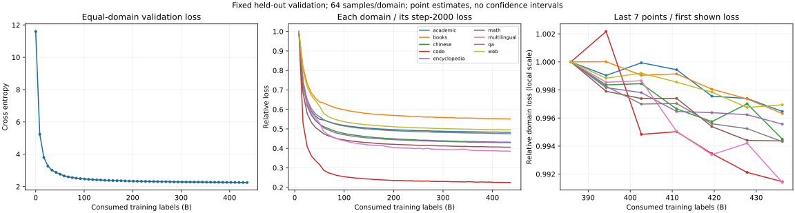

# YuFormer 阶段性技术报告

更新依据：2026-11-23T00:46:28.253923+00:00 的完整半日复核。原始复核状态 **HALF_DAY_REVIEW_DOMAIN_REGRESSION_REQUIRES_ATTENTION**。

**2026-11-23：1.5166B 正式预训练正在八张 H800 上运行。** 最近半日复核为第 60780 步，已消费 254.930B training labels，处于 stable 阶段；全链路预计 32.01 天，剩余约 24.41 天。这是运行时预测，最终能力尚未完成。最新验证聚合 loss 2.308152，逐域回升观察为 `{"validation_metrics/domain/books/loss": 0.12079104060711554}`。

## 数据与架构

正式三阶段数据在完整流、实际消费前缀配比、重叠、顺序和 tokenizer 绑定审计后冻结。统计使用最终 tokenizer 的 training labels；参考 token 用于选取和容量估算，不能替代训练预算。当前独特源集合约 821.290B reference tokens，不能称为 966B 独特训练 tokens。

模型为 1,516,600,064 参数、18L/H2560/FFN6912、40Q/10KV、head dim 64，SwiGLU、RMSNorm、QK normalization、tied embedding，每六层设置全局 attention，其余滑窗。最终 64K BBPE tokenizer 固定 SHA `5dd6bb3f9f587c301e2bb6bb8c987b725fa04d5c49230849038c7d7ec8c5cf9e`，EOS=0。配置见 [生产模型](../model/configs/pretrain_final_model_configs.yaml)。

## 规模实验与选型

八卡初筛比较 1B–5B，并保留实际 OOM、分配器抖动和短时测量限制。下表来自初始后端、24 updates、16 个稳态点，预算为单独 1T；它不能与后来确定性 Flash/Flex 生产结果混成同一后端的加速比。

| case / batch | 参数量 | P10 tokens/s/卡 | 1T 天数，duty .9 | 观测状态 |
|---|---:|---:|---:|---|
| baseline_053b_b8 | 530107904 | 74767.578125 | 21.500098416700503 | PASS_SCREENING |
| size_15b_b8 | 1516600064 | 35592.67578125 | 45.16407527058334 | PASS_SCREENING |
| size_1b_deep_b8 | 1002005248 | 44472.4921875 | 36.146170565131285 | PASS_SCREENING |
| size_1b_wide_b8 | 994652416 | 48307.8203125 | 33.27639867969552 | PASS_SCREENING |
| size_2b_b4 | 1966208512 | 26065.544921875 | 61.671846603781226 | PASS_SCREENING |
| size_2b_b8 | 1966208512 | — | — | OOM |
| size_3b_b4 | 2985462016 | 18603.8515625 | 86.40739164497101 | PASS_SCREENING |
| size_3b_b8 | 2985462016 | — | — | OOM |
| size_4b_b4 | 4009568256 | 9388.0361328125 | 171.22966564299537 | PASS_SCREENING |
| size_4b_b8 | 4009568256 | — | — | OOM |
| size_5b_b2 | 4956593664 | 11261.8603515625 | 142.73931995994013 | PASS_SCREENING |
| size_5b_b4 | 4956593664 | — | — | OOM |
| size_5b_b8 | 4956593664 | — | — | OOM |

4.010B microbatch4 虽完成，但预热后出现16301条分配器重试警告，不能作为可选生产结果；后续microbatch2对照约13386.6 tokens/s/卡、120.08天。详细失败与复测见 [规模实验流水账](GPU_MODEL_SIZE_SWEEP_20261114.md)。表内PASS_SCREENING只表示短测完成，不代表显存稳定、质量或生产准入。

宽深、LR、batch、attention backend 与显存策略继续独立优化。最终生产 200 步 canary P10 为 48648.06/卡，4K/16K/64K 整套初始预测 32.745 天。最终同后端、同实际 warmup 样本的 0.530B/1.5166B 对照及扩大开发验证通过逐域门禁；短学习曲线仍不能预测最终能力。证据见 [生产选型](../experiments/e2_architecture/results/model-scale-production-selection.json) 和 [选型分析](../experiments/e2_architecture/results/model-scale-scientific-assessment.json)，其中 preparation 标记属于发布时点。

1.5166B 是在用户优先较大模型、总工期不超过33天的约束下选取的生产候选；它不是最高tokens/s配置，也没有证明扩大模型不会延长训练。不能跨后端或数据口径对比来宣称算力收益。

E1 24 点 × 3 seeds 拟合 NRMSE 3.663% > 3%，保留 FAIL。用户显式豁免 E1 后采用独立系统、数据、数值和恢复门禁启动生产；不能说 E1 已证明最终模型最优。

## 冻结预算与课程

| 阶段 | labels | updates |
|---|---:|---:|
| 4k-pretrain | 916,258,291,712 | 218,453 |
| 16k-midtrain | 29,997,662,208 | 7,152 |
| 64k-midtrain | 19,998,441,472 | 4,768 |

总计 **966,254,395,392 labels**，相对名义 1T 减少约 3.3746%，减少部分来自 stable，已明确预算口径。4K warmup/stable/decay 为 11921/170770/35762 updates，分别消费 50,000,297,984 / 716,261,294,080 / 149,996,699,648 labels。4K world=8、microbatch=8、grad_accum=16；global batch=4,194,304 labels。AdamW、clip=1，peak LR=1e-4，WSD 末端比例 0.1。

实际 warmup→stable 边界已检查；训练数据使用独立 B8 block permutation，按 global sample cursor 恢复。全阶段总配比通过并不能排除时间漂移，因此另行验证实际消费切片、独立校准和恢复后的下一样本。

16K 为 microbatch2/accum16，64K 为 microbatch1/accum8，均 HSDP 2×4、同一 global batch。peak LR=2e-5、warmup72/48、cosine 到 2e-6；25% 短样本 replay。64K 使用 MLP 重计算、32 路 loss chunk 和已资格验证的分配器/保存策略。跨阶段 weight-only，同阶段 full-state resume。

## 正式训练进展与可靠性

正式训练于 2026-11-15 启动。最近复核：第 60780 步，254,929,797,120 labels，phase=stable，训练 loss=2.3253，每卡 TPS=47746，CUDA 峰值 67.46 GiB。共 243 份周期检查点历史验收记录、6080 个实际 LR 标量重新核对。结构/控制状态检查不等于每次都重扫全部浮点；首250步完整有限性扫描及独立保存另有证据。

实际故障资格包含八卡 SIGKILL 后完整优化器、调度器、数据游标与全 rank RNG 恢复，已测路径逐步 loss 差为0。2026-11-18 外围进程遭 SIGKILL，发送来源未知，cgroup OOM kill=0；原八卡训练存活，通过显式原 generation/token 接管恢复守护，训练未重启。不能仅凭旧 RUNNING、PID 存在或显存高判断健康。

最新固定九域验证第 60000 步，聚合 loss=2.308151960；逐域短窗回升 `{"validation_metrics/domain/books/loss": 0.12079104060711554}`。每域固定64样本、262144目标 tokens，聚合为等域宏平均。这是早期点估计，无此处置信区间，不代表公开 benchmark 或最终能力。2026-11-23 books +0.1208% 观察的跟进记录保留，未修改原复核状态或配方。

## 长阶段与后训练边界

4K 完成后控制器必须核对真实 terminal、完整计数和 native checkpoint，再运行 16K。实际 baseline/candidate 的 RULER、长文 BPB、固定短能力与 RepoQA 四组规则重新计算通过后，才准入64K。系统 smoke 和 gold 自测不能充当最终质量；RepoQA 公共代码有污染风险，报告 no-context control，不能称为无污染公开成绩。

长数据与八卡 4K→16K→64K 系统切换、两阶段完整恢复已过资格；真实生产长阶段和最终能力尚未完成。SFT 已有对话状态机、tool call 与 assistant-only packing；RL 已有独立 verl/SGLang 锁版与 rollout 契约，模型 adapter、完整训练和效果验证尚待完成。

## 复用经验与证据

[工程经验手册](../docs/engineering/PLAYBOOK.md) 和 [异常案例库](../docs/engineering/INCIDENTS.md) 覆盖预处理内存、缓存失效、顺序/配比、LR 边界、CUDA context、保存、恢复、评测和运维。新项目复用规则和反例，重新绑定自身数据、模型、依赖和硬件，不继承旧 PASS。

公开轻量数据见 [metrics](metrics/README.md)：CSV、当前机器快照和来源 SHA。原始语料、权重、事件前缀和完整运行证据属于外部资产，未随 Git 打包。报告以实际测量为依据，未把预测工期、未执行的后训练或准备标记写成已完成结果。
